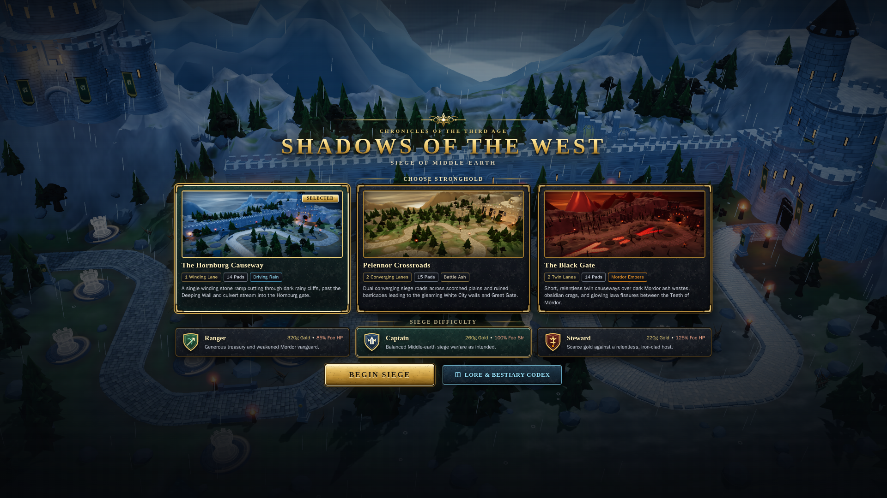
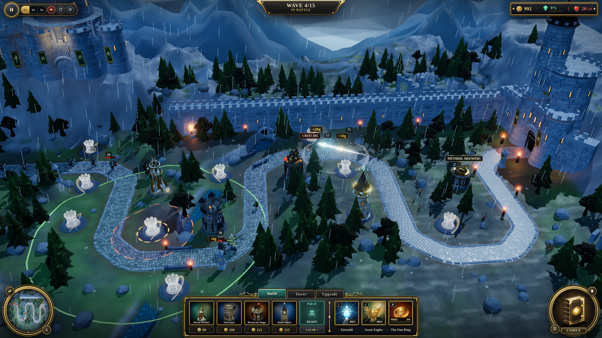
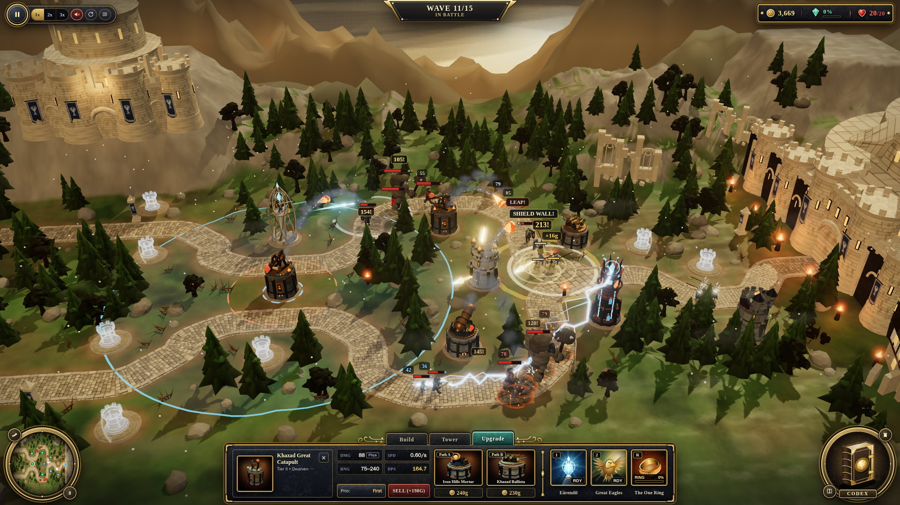
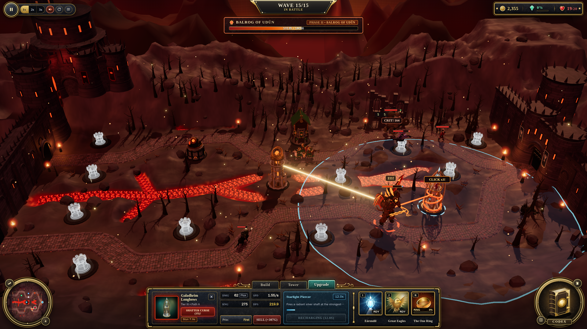
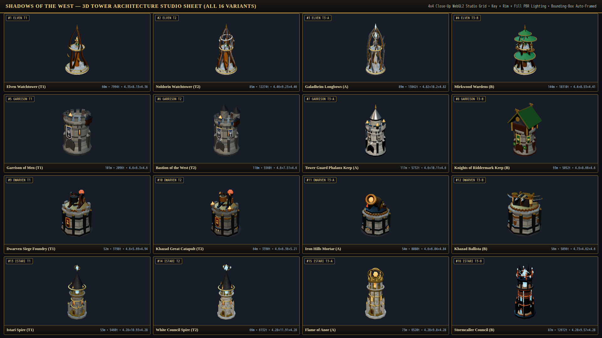
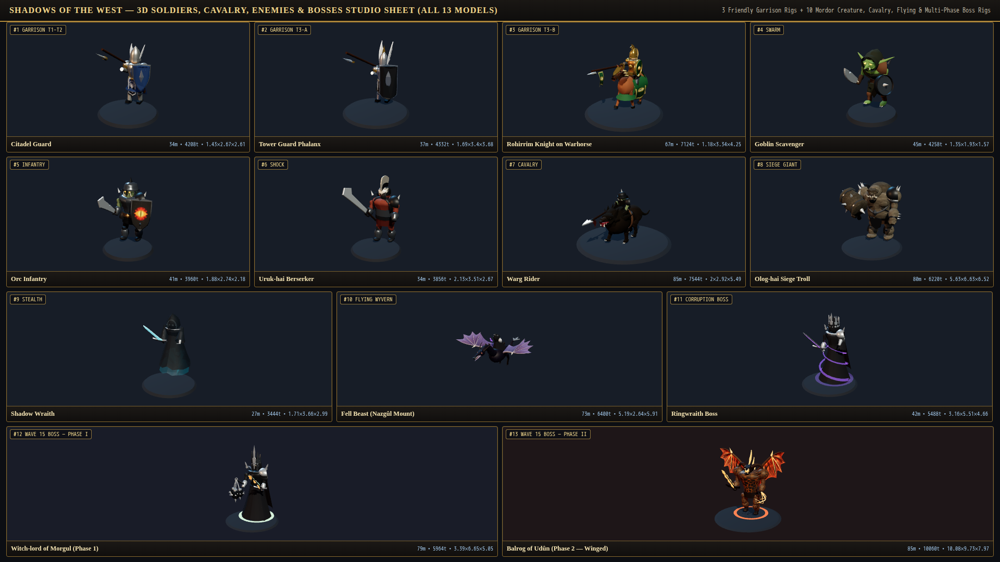

# Shadows of the West — Siege of Middle-earth

> **A full 3D Dark-Fantasy Tower Defense game set in Middle-earth — delivered inside a single self-contained `index.html` (`~2.4 MB`, `0` external assets, `0` network requests).**
>
> Built with **Three.js (WebGL2 + UnrealBloom post-processing)** and **procedural Web Audio** orchestration & sound synthesis. Crafted with **Gemini 4 Carbon and Hydrogen**.

[](https://artem-kaseka.github.io/shadows-of-the-west/)
[](https://github.com/artem-kaseka/shadows-of-the-west/releases/tag/v1.0.0)



---

## Highlights

- **Single-File Zero-Dependency Runtime (`index.html`)** — All 3D procedural geometry, PBR materials, custom shaders, UI, particle VFX, orchestral Web Audio score, and SFX are compiled into one standalone HTML file with **zero external URLs, textures, fonts, or audio files**. Works completely offline from `file://` or any static host.
- **3 Sculpted 3D Stronghold Campaigns** — Defend **15 structured siege waves** (plus **Endless Mode** and 3 difficulty tiers) across:
  1. **The Hornburg Causeway** — Driving storm rain, flickering Deeping Wall torches, culvert stream, and wet stone causeway.
  2. **Pelennor Crossroads** — Golden sunbreak vista beneath *Minas Tirith* with dual converging siege roads.
  3. **The Black Gate** — Volcanic Mordor waste of obsidian fangs, glowing magma fissures, and multi-lane assault under the Lidless Eye.
- **4 Tower Archetypes, 16 Procedural 3D Tower Models & 8 Tier-3 Specializations** — Every Tier-3 branch unlocks a distinct 3D architectural sculpt, passive combat trait, and active cooldown ability.
- **9-Unit Bestiary + 2-Phase Winged Balrog Boss** — Battle *Goblin Scavengers*, *Orc Infantry*, *Uruk-hai Berserkers*, leaping *Warg Riders*, regenerating *Olog-hai Siege Trolls*, stealth *Shadow Wraiths*, flying *Fell Beasts*, *Ringwraiths*, and the **Witch-lord / Winged Balrog of Udûn** (`10,060`-triangle Phase II boss).
- **The One Ring Risk/Reward System** — Slip on **The One Ring (`R`)** to empower all towers & garrisons (`+40%` attack rate, `+25%` kill gold, global **True Sight** against Shadow Wraiths), while **Ring Corruption** climbs toward `100%` — drawing a **Ringwraith Boss** with tower-freezing *Black Breath* straight onto the battlefield.
- **Global Powers & Interactive Boss Counterplay** — Call down **Light of Eärendil (`1`)** or a **Great Eagles Strike (`2`)**, set custom Garrison rally points, and click cursed towers **3×** to shatter the Balrog's *Dark Spell Lock*.

---

## 1080p 3D Gameplay Gallery

### The Hornburg Causeway — Storm Siege & 3D Studio Build Dock


### Pelennor Crossroads — Tier-3 Specialization & Upgrade Inspector


### The Black Gate — Phase II Winged Balrog of Udûn & Spell-Lock Counterplay


### Procedural 3D Model Sheets — All 16 Towers & 13 Allied / Enemy Rigs
| All 16 Sculpted 3D Tower Models (T1 → T2 → T3 Branches A & B) | Allied Soldiers, Rohirrim Cavalry & Mordor Bestiary |
| :---: | :---: |
|  |  |

> **Full 2-Minute 1080p Gameplay Trailer (with Orchestral Score & SFX):** Available on the [**v1.0.0 GitHub Release**](https://github.com/artem-kaseka/shadows-of-the-west/releases/tag/v1.0.0) (`epic_demo_2min_1080p.mp4`).

---

## Towers, Tier-3 Branches & Active Skills

| Archetype | Tier 1 → Tier 2 | Tier 3 Branch A | Tier 3 Branch B |
| :--- | :--- | :--- | :--- |
| **Elven Watchtower**<br>*(Ranged Physical · Anti-Air · 20% Armor Pierce)* | *Elven Watchtower* →<br>*Noldorin Watchtower* | **Galadhrim Longbows**<br>275 range, 30% 3× crit + bleed.<br>*Skill:* **Starlight Piercer** (massive true/crit shot + 1.5s stun) | **Mirkwood Wardens**<br>Rapid 3-arrow multi-target volley.<br>*Skill:* **Woodland Pinning Volley** (6-arrow hail + 45% slow) |
| **Garrison of Men**<br>*(Melee Road Blockers · Custom Rally)* | *Garrison of Men* →<br>*Bastion of the West* | **Tower Guard Phalanx**<br>420 HP, 60% armor, 85px Taunt Aura (`-20%` foe melee DMG).<br>*Skill:* **Citadel Shield Wall** (40% heal + 90% DR) | **Knights of the Riddermark**<br>Mounted Rohirrim lancers, 2.5× charge & 48px cleave.<br>*Skill:* **Forth Eorlingas!** (cavalry trample + stun) |
| **Dwarven Siege Foundry**<br>*(Heavy AoE Artillery · 75px Min Range)* | *Dwarven Siege Foundry* →<br>*Khazad Great Catapult* | **Iron Hills Mortar**<br>105px blast + 4.5s burning oil (halts Troll regen).<br>*Skill:* **Dragonfire Barrage** (3 incendiary shells) | **Khazad Ballista**<br>Linear piercing siege bolts + permanent 50% armor shred.<br>*Skill:* **Mithril Skewer** (2× damage line pierce + knockback) |
| **Istari Spire**<br>*(Arcane Magic · Anti-Air · Slow & True Sight)* | *Istari Spire* →<br>*White Council Conclave* | **Flame of Anor**<br>Continuous fire/arcane beam ramping `1.0× → 3.5×` DPS.<br>*Skill:* **Secret Fire Nova** (95px shockwave + 1.5s stun) | **Stormcaller Council**<br>5-target chain lightning + 25% path knockback.<br>*Skill:* **Tempest of Manwë** (sky bolts + guaranteed pushback) |

---

## Bestiary of Shadow

1. **Goblin Scavenger** — High-speed swarm runners charging in tight packs of 15–20.
2. **Orc Infantry** — Shielded Mordor footmen (`20%` physical armor).
3. **Uruk-hai Berserker** — Heavy shock infantry (`35%` armor) triggering **Blood Rage** below `40%` HP (`+50%` move & attack speed).
4. **Warg Rider** — Swift wolf cavalry using **Predator Leap** (`10s` CD) to vault straight over the first Garrison blocker.
5. **Olog-hai Siege Troll** — Living battering ram (`60%` armor, AoE club smash) that regenerates `18 HP/s` unless seared by **Fire or Magic**.
6. **Shadow Wraith** — Spectral assassin with `80%` physical dodge unless illuminated by an *Istari Spire*, *Light of Eärendil*, or *The One Ring*.
7. **Fell Beast** — Winged aerial predator bypassing ground walls and blockers; vulnerable only to anti-air towers and spells.
8. **Ringwraith Boss** — Summoned immediately at `100%` Ring Corruption; pulses **Black Breath** (`165px` radius, `4.0s` tower stun).
9. **The Witch-lord / Balrog of Udûn** — Wave 15 Grand Siege Overlord. Commands the assault as the crowned Witch-lord before erupting at `<50%` HP into a winged Demon of Shadow and Flame, casting **Dark Spell Lock** on towers (`click 3×` to shatter the curse).

---

## Controls & Hotkeys

| Input | Action |
| :--- | :--- |
| **Left Click** | Select 3D build pad / tower, place spell target, set rally point, or shatter *Spell Lock* (`3×` clicks) |
| **Right Click / Drag** | Pan 3D tactical camera (or cancel active targeting) |
| **Mouse Wheel** | Smooth 3D tactical camera zoom in / out |
| **`1`** | Select **Light of Eärendil** spell (`45s` CD — AoE `2.5s` stun + `30s` True Sight reveal) |
| **`2`** | Select **Great Eagles Strike** spell (`70s` CD — directional 3D Great Eagles strafing run) |
| **`R`** | Toggle **The One Ring** (`+40%` fire rate, `+25%` kill gold, True Sight vs. rising Corruption) |
| **`Space`** | Pause / Resume tactical time |
| **`Esc`** | Cancel spell / rally targeting, close Tome of the West Codex, clear selection, or toggle Pause |

---

## How to Play & Rebuild

### Instant Play (Zero Install)
- **Play in Browser:** [**https://artem-kaseka.github.io/shadows-of-the-west/**](https://artem-kaseka.github.io/shadows-of-the-west/)
- **Open Directly from Disk:** Double-click or run `open index.html` (macOS) / `xdg-open index.html` (Linux) — no server required.
- **Local Dev Server:**
  ```bash
  node scripts/serve.mjs
  # Serves http://localhost:8000/
  ```

### Rebuild `index.html` from Source
All modular sources live in `src/` (`three_scene.js`, `env_3d.js`, `models_towers_3d.js`, `models_enemies_3d.js`, `models_3d.js`, `vfx_3d.js`, `towers.js`, `enemies.js`, `maps.js`, `fx_audio.js`, `ui.js`, `engine.js`, and `styles.css`). To bundle Three.js and recompile the single-file `index.html`:

```bash
npm install
npm run build   # runs: node scripts/build.mjs
```

The build script bundles Three.js + post-processing via `esbuild`, validates syntax with `node:vm`, and enforces a strict static audit guaranteeing **zero external URLs** in `index.html`.

---

## Credits

Designed, sculpted in procedural 3D, scored, and engineered with **Gemini 4 Carbon and Hydrogen**.
